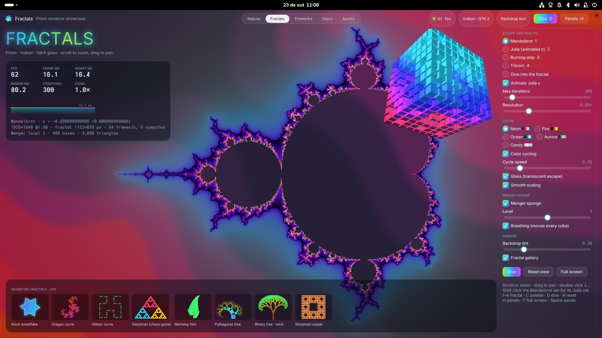
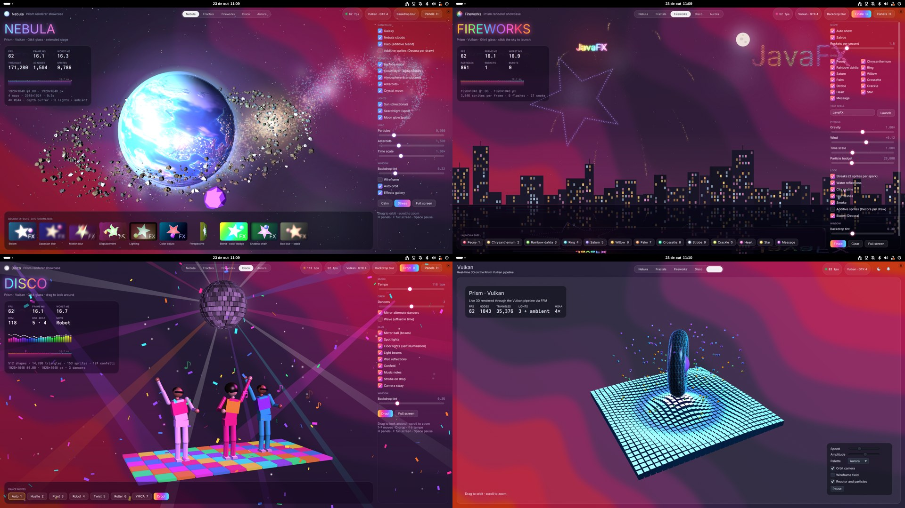
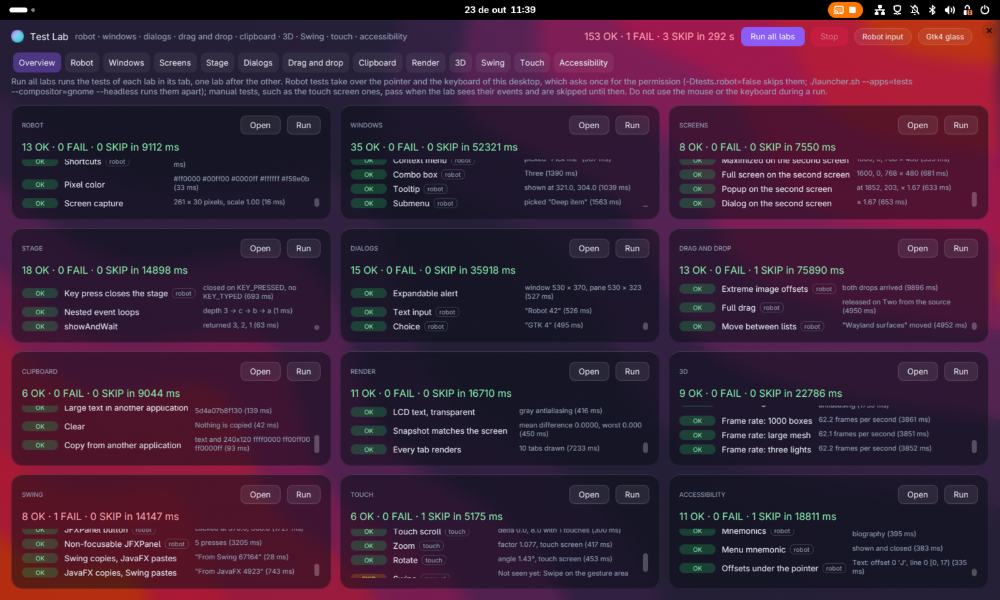

# jfx-wayland

JavaFX on Wayland.

> [!WARNING]
> Most of this code was developed by an AI model. It is meant for
> demonstration and as a proof of concept only, and has not been reviewed for
> production use. Do not use it in production.

## How it works

The project is one jar for an unmodified JavaFX with a Glass on GTK 4 for
Wayland (`-Dglass.platform=Gtk4`) and two Prism pipelines, Vulkan (`vk`) and
OpenGL (`gl`). It is all Java: GTK, Vulkan, EGL and libei are called through
the Foreign Function & Memory API, with [bindings](#bindings) generated at
build time.

### Bindings

- GTK 4, GDK, GLib, GObject, Gio and libadwaita: the `generateGtk4Wrappers`
  task reads their GObject introspection files (`*.gir`) and writes a Java
  class for each type the glass uses (listed in `build.gradle`), with the
  GObject hierarchy (`GtkPicture extends GtkWidget`) and methods that make
  the native calls, converting strings, objects and callbacks. A function is
  looked up the first time it is called, and `isAvailable()` tells whether
  the GTK at run time has it, so the plugin is built with the GIR files of a
  recent GTK and still runs on GTK 4.14.
- Vulkan: the `generateVulkanBindings` task reads the Vulkan registry
  (`vk.xml`) and writes a `VK` class with the constants and commands the
  pipeline uses, and a class per structure with its memory layout.
- EGL, GBM and OpenGL: a hand-written list of functions (`GLNative`), the
  OpenGL ones resolved through `eglGetProcAddress`; libei, a small
  hand-written wrapper (`Ei`).

The generated sources go to `build/generated/sources`.

### Rendering

```
Prism (vk / gl) ──► dma-buf ──► GdkDmabufTexture ──► GtkGraphicsOffload ──► compositor
```

The pipeline renders each frame into a dma-buf, a GPU buffer that can be
shared between processes. GTK shows it inside a `GtkGraphicsOffload`, which
hands the buffer to the compositor as a Wayland subsurface, so the frame
reaches the screen without being copied. A sync file attached to the buffer
lets the compositor, not the application, wait for the GPU to finish. The
software pipeline, which has no dma-buf, uploads its pixels to GTK instead.

The shaders of both pipelines are generated from the JSL sources of JavaFX.

### Robot

Wayland clients cannot inject input or read the screen, so
`javafx.scene.robot.Robot` uses libei, the library of the compositors for
emulated input. It gets its connection from the RemoteDesktop portal, which
asks the user once for permission, or, in the nested GNOME Shell of the
launcher, from its remote desktop session, without asking. Through libei it
moves the pointer, clicks, scrolls, types and touches the screen. Pixels are
read from the frames of the application windows themselves.

### Windows on Wayland

Wayland does not let clients place their windows or know where they are. The
glass follows this, except in the nested GNOME Shell of the tests, where it
asks the shell to place its windows, which the tests of positions and of
multiple monitors need.

Everything else maps to GTK: windows and their decorations, input methods,
clipboard and drag and drop, file dialogs through the portal, and
accessibility, which GTK exposes to screen readers through AT-SPI.

## Requirements

- JDK 25
- A JavaFX SDK of the version the plugin is built against, since it uses
  internal APIs, with no `com.sun.glass.ui.gtk4` or `com.sun.prism.vk`
  classes in `javafx.graphics`
- The GObject introspection files of GTK 4.22 or later (`Gtk-4.0.gir`,
  `Gdk-4.0.gir`, `GdkWayland-4.0.gir`, `Adw-1.gir`, ...), since the wrappers
  are generated from its API. The glass checks the version of GTK at run time,
  so the plugin runs on GTK 4.14 or later. On a system with an older GTK, set
  `girDir` to the `gir-1.0` directory of a newer one.
- The Vulkan registry (`vk.xml`) and a Vulkan 1.3 driver
- `libshaderc` or `glslc`

## Build

```
./gradlew jar -PjfxSdk=/path/to/jfx/build/sdk
```

| Property     | Default                              |
|--------------|--------------------------------------|
| `jfxSdk`     | `../jfx/build/sdk`                   |
| `girDir`     | `/usr/share/gir-1.0`                 |
| `vkRegistry` | `/usr/share/vulkan/registry/vk.xml`  |

The build generates:

- the GTK 4 FFM wrappers from the GIR files (`generateGtk4Wrappers`)
- the Vulkan FFM bindings from `vk.xml` (`generateVulkanBindings`)
- the Vulkan GLSL of the Prism and Decora shaders from JSL, compiled to SPIR-V
  (`generatePrismShaders`, `generateDecoraShaders`, `compile*SPIRVShaders`)
- the OpenGL 4.5 core GLSL of the same shaders, from the `-gl` backend of the
  JSL compiler, and of the static Vulkan shaders, whose descriptor sets, push
  constants and specialization constants become bindings, a uniform block
  and macros (`copy*GLShaders`, `generateGLStaticShaders`)

## Run

The plugin runs with an unmodified JavaFX: a released SDK, the JavaFX jars
from Maven Central, or an SDK built from source. It was tested with JavaFX
27.0.1 and with a build of the master branch.

### Runtime requirements

- JDK 25
- JavaFX of the version the plugin was built against (the plugin uses its
  internal APIs), with no `com.sun.glass.ui.gtk4` or `com.sun.prism.vk`
  classes in `javafx.graphics`
- `jfx-wayland.jar`, from `build/libs` (it contains the generated wrappers and
  the SPIR-V shaders, so the GIR files, `vk.xml` and `libshaderc` are only
  needed to build it)
- GTK 4.14 or later (`libgtk-4.so.1`), which has `GtkGraphicsOffload`: the
  frames are shown in a `GtkGraphicsOffload`, so that GTK can hand the
  dma-bufs to the compositor as subsurfaces. The glass refuses to start with
  an older GTK. libadwaita is used when available.
- For the `vk` pipeline: the Vulkan loader (`libvulkan.so.1`) and a driver
  with Vulkan 1.3 and `VK_KHR_push_descriptor`. Frames are handed to the
  compositor as dma-bufs when the driver also has `VK_KHR_external_memory_fd`
  and `VK_EXT_external_memory_dma_buf`, and copied otherwise.
- For the `gl` pipeline (`-Dprism.order=gl`): EGL 1.5 with the GBM platform,
  `EGL_KHR_surfaceless_context` and `EGL_EXT_image_dma_buf_import`, and an
  OpenGL 4.5 core driver with `GL_OES_EGL_image`, on a render node
  (`/dev/dri/renderD128` and the next ones, or `-Dprism.gl.device=PATH`). It
  renders with an upper-left origin and a [0, 1] depth range
  (`glClipControl`), as Vulkan does, so both pipelines share their shaders,
  projections and exported frames: linear ARGB8888 buffers of the render
  node, synchronized with a sync file when `EGL_ANDROID_native_fence_sync` is
  available. It does not use the ES2 pipeline of JavaFX.
- A Wayland compositor (GNOME, KDE Plasma, ...). Xorg is not supported: the
  glass does not work in an X11 session, nor with `GDK_BACKEND=x11`.

These requirements are checked when JavaFX starts:

- The glass fails to start, with the reason, when GTK 4 cannot be loaded, is
  older than 4.14, or lacks `GtkGraphicsOffload` or `GdkDmabufTextureBuilder`,
  and when there is no Wayland compositor (no socket at `$WAYLAND_DISPLAY`, or
  `GDK_BACKEND` selects another backend).
- The pipelines are tried in the order of `prism.order`, `vk,gl,sw` by
  default: Vulkan, then OpenGL when Vulkan cannot be used, and the software
  pipeline when neither can. The `vk` pipeline prints why Vulkan cannot be
  used (no loader, no Vulkan 1.3 device, no `VK_KHR_push_descriptor`, ...),
  and the `gl` pipeline does the same for EGL and OpenGL.
  `-Dprism.verbose=true` shows the devices and the extensions in use.

### Command line

```
java --module-path=/path/to/javafx/lib --add-modules=javafx.controls \
     --enable-native-access=javafx.graphics,ALL-UNNAMED \
     --add-exports=javafx.base/com.sun.javafx=ALL-UNNAMED \
     --add-exports=javafx.base/com.sun.javafx.logging=ALL-UNNAMED \
     --add-exports=javafx.graphics/com.sun.glass.events=ALL-UNNAMED \
     --add-exports=javafx.graphics/com.sun.glass.ui=ALL-UNNAMED \
     --add-exports=javafx.graphics/com.sun.glass.ui.delegate=ALL-UNNAMED \
     --add-exports=javafx.graphics/com.sun.javafx.application.preferences=ALL-UNNAMED \
     --add-exports=javafx.graphics/com.sun.javafx.geom=ALL-UNNAMED \
     --add-exports=javafx.graphics/com.sun.javafx.geom.transform=ALL-UNNAMED \
     --add-exports=javafx.graphics/com.sun.javafx.sg.prism=ALL-UNNAMED \
     --add-exports=javafx.graphics/com.sun.javafx.tk=ALL-UNNAMED \
     --add-exports=javafx.graphics/com.sun.prism=ALL-UNNAMED \
     --add-exports=javafx.graphics/com.sun.prism.impl=ALL-UNNAMED \
     --add-exports=javafx.graphics/com.sun.prism.impl.ps=ALL-UNNAMED \
     --add-exports=javafx.graphics/com.sun.prism.paint=ALL-UNNAMED \
     --add-exports=javafx.graphics/com.sun.prism.ps=ALL-UNNAMED \
     --add-exports=javafx.graphics/com.sun.prism.shader=ALL-UNNAMED \
     -Dglass.platform=Gtk4 -Dprism.order=vk,gl,sw \
     -cp jfx-wayland.jar:app.jar app.Main
```

The plugin is on the class path, so the exports are to `ALL-UNNAMED`. With
JavaFX on the class path too (no module path), the `--add-exports` options are
not needed, but JavaFX reports it as an unsupported configuration and the main
class must not extend `Application`.

`./gradlew -q runArgs -PjfxSdk=DIR` prints these arguments for an SDK, and the
build writes them to `build/run.args`, for `java @build/run.args` (paths under the
home directory are relative to the project directory, from where it must run).

JavaFX loads `com.sun.glass.ui.gtk4.Gtk4PlatformFactory` for
`-Dglass.platform=Gtk4`, and `com.sun.prism.vk.VKPipeline` and
`com.sun.prism.gl.GLPipeline` for the `vk` and `gl` entries of `prism.order`. With a JavaFX that supports the `ext:` prefix, the classes
can also be given by name: `-Dglass.platform=ext:com.sun.glass.ui.gtk4.Gtk4PlatformFactory`.

| System property              | Description                                             |
|------------------------------|---------------------------------------------------------|
| `glass.gtk4.backdrop=true`   | Blurs the area behind toplevel windows, see [Backdrop](#backdrop) |
| `glass.gtk4.backdrop.active` | Set by the glass: whether the backdrop is in use            |
| `glass.gtk4.adwaita=false`   | Uses `GtkWindow` instead of `AdwWindow`                  |
| `glass.gtk4.portal=false`    | Uses GTK file dialogs instead of the portal             |
| `glass.gtk4.verbose=<cats>`  | Logs the given categories, or `all`                     |

## Backdrop

With `-Dglass.gtk4.backdrop=true`, the compositor blurs the area behind every
toplevel window that is not transparent, when it supports the
`ext-background-effect-v1` protocol (GNOME 51). The compositors that support
it are listed at <https://wayland.app/protocols/ext-background-effect-v1>.
The blur shows through where the scene fill and the content are transparent or
translucent, so the application sets a transparent `Scene` fill.

When the compositor does not support the protocol, the backdrop is disabled
and a warning is printed. The glass sets `glass.gtk4.backdrop.active` to `true`
or `false` before the application starts, so that the application can use an
opaque fill when there is no blur behind the window, as the demos do.

This property stands in for the `StageBackdrop` API of
[openjdk/jfx#2048](https://github.com/openjdk/jfx/pull/2048) (8375578: Enable
translucent window backdrops), which selects the backdrop per stage. When that
API is available in JavaFX, the plugin will implement it and the property will
be removed.

## Demos

`demos/` has two applications, which `launcher.sh` runs (see below):

- `eyecandy`, the showcases of the Prism renderer in one window, chosen in
  the middle of its header bar or with Ctrl+1 to Ctrl+5: Nebula (a planet, its
  moon, a galaxy and a nebula in 3D), Fractals (Mandelbrot and Julia sets
  computed in the background, geometric fractals and a Menger sponge),
  Fireworks, Disco and Aurora. `-Deyecandy.show=fractals` starts on one;
- `tests`, the tests of the platform integration (see [Tests](#tests)).

`Wallpaper.java` is the animated desktop of `launcher.sh` under KWin.

```
./launcher.sh
./launcher.sh -- -Deyecandy.show=fractals
```






## Tests

`tests` runs the tests of the GTK 4 glass and of the Prism pipelines, in a
lab per area, after the manual tests and the system tests (`tests/system`) of
OpenJFX. Each lab is a tab, with what it tests on one side and its table of
tests on the other, which show OK, FAIL or SKIP; the overview shows the
results of every lab, and Run all labs runs them one lab after the other.
Every run can be stopped.



| Lab             | Tests                                                                    |
|-----------------|--------------------------------------------------------------------------|
| Robot           | `javafx.scene.robot.Robot`: pointer, buttons, wheel, keyboard, pixels and screen capture; the mouse location and the wheel scale (MouseLocationOnScreenTest, MouseWheelScaleTest) |
| Windows         | Every window style, focus, maximized, full screen and minimized states before and after show, modality, min and max sizes, popups |
| Screens         | Two monitors of different scales: stages, popups and dialogs on the second one, moves between them, maximized and full screen there |
| Stage           | A stage playground (styles, backdrops, owners, properties), and sizeToScene, new scene sizes, iconify, redraw after deiconify, ownership, modal children, key events that close a stage, nested event loops and showAndWait (SizeToSceneTest, NewSceneSizeTest, IconifyTest, DrawAfterDeiconifyTest, DeiconifiedWithChildTest, StageOwnershipTest, SceneChangeShouldNotFocusStageTest, SetSceneScalingTest, KeyEventClosesStageTest, NestedEventLoopTest, ShowAndWaitTest) |
| Dialogs         | File and folder choosers (through the portal), extension filters, alerts, text input and choice dialogs, dialog sizes (DialogRepeatedShowHideTest, DialogWithOwnerSizingTest, MakeResizableAndResizeTest) |
| Drag and drop   | Transfer modes and modifiers, data formats, drag images and offsets, drops from and to other applications, full drag |
| Clipboard       | Copy and paste of text, HTML, RTF, URLs, files, images and custom formats, checked by a second process and with `wl-copy` and `wl-paste` |
| Render          | A showcase of shapes, paints, text, images, effects, blending, canvases, 3D and CSS, and sRGB colors, PixelBuffer updates, LCD text, snapshots (SRGBTest, PixelBufferDrawTest, TransparentLCDTest, Snapshot1Test) |
| 3D              | 3D rendering checked on the screen and in snapshots, and the frame rate of heavier scenes; skipped on the `sw` pipeline |
| Swing           | SwingNode painting and input, a JFXPanel in a JFrame, a non-focusable JFXPanel (NonFocusableJFXPanelTest), the EDT and FX threads, and the clipboard between Swing (X11, through Xwayland) and JavaFX |
| Touch           | Touch points and the scroll, zoom and rotate gestures, with the touch screen of the robot; swipe with a touchpad |
| Accessibility   | Accessible roles, names and states, live changes, and the AT-SPI tree read as a screen reader does |

There are four kinds of tests (see `demos/TestKit.java`):

- automatic tests check what the lab can do alone, such as reading back the
  pixels of a window, the clipboard in a second process, or the AT-SPI tree of
  the application with `python3` and the Atspi bindings;
- robot tests drive the lab with `javafx.scene.robot.Robot`. The GTK 4 glass
  generates robot input with libei: on the desktop of the user through the
  RemoteDesktop portal, which asks once for the permission and then takes over
  the pointer and the keyboard, or in the nested GNOME Shell of
  `--compositor=gnome`, which leaves the desktop alone. `-Dtests.robot=false`
  skips them, and they are skipped when the desktop has no robot input;
- touch tests touch the lab with the touch screen that libei and the
  compositor offer to the robot, when they do (GNOME 51 does);
- manual tests wait for a device the robot does not have, such as a
  touchpad: they pass when the lab sees their events, or with their OK and
  FAIL buttons.

### Running the tests

The tests run best in the nested GNOME Shell of the launcher (GNOME 51, in a
toolbox container, see [Launcher](#launcher)), where the robot does not take
over the desktop and windows can be placed at given positions. With
`--headless` the shell has no window at all, so that the desktop stays free
and its focus does not matter, and it gets a second monitor at another scale
for the Screens lab (which a shell with a window gets with
`--monitors=1600x960@1,1280x800@2`, in a second window):

```
./launcher.sh --apps=tests --compositor=gnome --headless -- -Dtests.run=true -Dtests.exit=true
```

`-Dtests.run=true` runs the tests at startup and `-Dtests.exit=true` exits
afterwards, with status 1 when a test failed; each result is also printed, as
`OK`, `FAIL` or `SKIP` lines, and as a summary per lab. Other options:

| Option                          | Effect                                                     |
|---------------------------------|------------------------------------------------------------|
| `-Dtests.labs=robot,windows`    | Keeps only these labs, by name without spaces              |
| `-Dtests.robot=false`           | Skips the robot tests                                      |
| `--pipeline=vk\|gl\|sw`         | Runs them on one Prism pipeline                            |
| `--monitors=1600x960@1,1280x800@2` | The monitors of the nested shell and their scales        |
| `--screenshot=FILE`             | Saves a screenshot of the nested desktop (with `--headless`, then ends) |

Without `--compositor`, the tests run on the current desktop, which asks once
to allow the remote control of the robot; the Screens lab is skipped there:

```
./launcher.sh --apps=tests
```

The toolbox container gets the tools of the tests (`wl-clipboard`,
`python3-gobject` and the AT-SPI registry of `at-spi2-core`) when it is
created, and a container created before them gets them on the next run.

## Launcher

`launcher.sh` runs one or more demos together, on the current desktop or in a
nested compositor, with the plugin and the JavaFX SDK of `build/run.args`, so
the plugin is built first with `./gradlew jar`.

```
./launcher.sh
./launcher.sh --apps=all --compositor=kwin
./launcher.sh --apps=tests --compositor=gnome --headless -- -Dtests.run=true -Dtests.exit=true
./launcher.sh --pipeline=sw --backdrop=off -- -Deyecandy.show=disco -Dglass.gtk4.verbose=all
```

| Option                       | Description                                                     |
|------------------------------|-----------------------------------------------------------------|
| `--apps=a,b,...`             | Demos to run, `eyecandy` or `tests`, or `all` (`eyecandy`)     |
| `--compositor=none\|gnome\|kwin` | Current desktop, or a nested compositor (`none`)        |
| `--pipeline=auto\|vk\|gl\|sw`  | Prism pipeline: Vulkan, OpenGL 4.5 or software; `auto` tries them in that order (`auto`) |
| `--backdrop=on\|off`          | Sets `glass.gtk4.backdrop` (`on`)                              |
| `--toolbox=NAME`             | Toolbox container with GNOME 51 (`jfx-gnome51`), or `none` for the GNOME Shell of the host |
| `--toolbox-release=N`        | Fedora release of a new toolbox container (`45`)               |
| `--wallpaper=FILE`           | gnome: desktop image; kwin: `javafx` for `Wallpaper.java`      |
| `--size=WxH`, `--scale=N`    | gnome, kwin: size of the nested output (2400x1440); kwin: its scale |
| `--monitors=WxH@S,...`       | gnome: monitors side by side, with their scales, each in a window of its own without `--headless` (`SIZE@1`; `tests` with `--headless`: `SIZE@1,1280x800@2`) |
| `--headless`                 | gnome: no window on the desktop, virtual monitors instead; the host focus does not matter |
| `--screenshot=FILE`          | gnome: screenshot of the nested desktop                        |
| `--list`, `--help`           | Lists the demos, or shows all the options                      |

Arguments after `--` are passed to the JVM of the demos. The logs are written
to `$TMPDIR/jfx-wayland-launcher-<compositor>`.

With `--compositor=gnome`, GNOME Shell runs in a toolbox container, so that
GNOME 51 can be used on an older host. When the container does not exist, the
launcher asks before creating it from Fedora 45 and installing GNOME Shell,
the JDK, GTK 4 and the Vulkan drivers in it.

